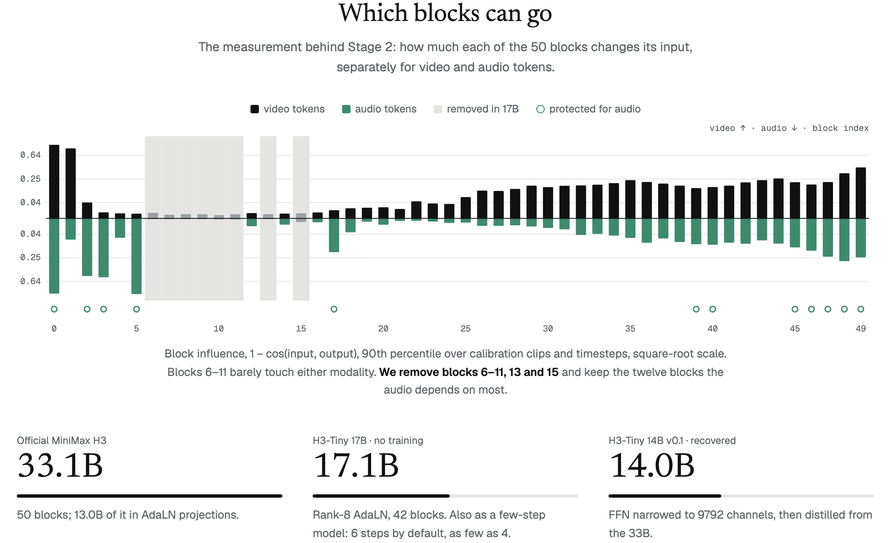

<div align="center">

# H3-Tiny

**Structured pruning of MiniMax H3 Ref2VA: 33B → 17B → 14B**

[](https://fuyi25.github.io/H3-Tiny/)
[](https://huggingface.co/H3-Tiny)

[](LICENSE)


<sub>Samples from <b>H3-Tiny 17B</b>: pruned with no training, 50 steps, with its own synchronized audio.</sub>

</div>

Joint video + audio generation from text and reference images, at about half the size of the original, with recovered
and few-step checkpoints.

<p align="center"></p>

## News

- **[2026/11/19]** We release the pruning and inference code and the [project page](https://fuyi25.github.io/H3-Tiny/).
- **[2026/11/19]** We release three checkpoints on [Hugging Face](https://huggingface.co/H3-Tiny): `H3-Tiny-17B-Pruned`,
  `H3-Tiny-17B-FewStep-v0.1` and `H3-Tiny-14B-OKD-v0.1`.

## Checkpoints

| Checkpoint | Parameters | Made by | Sampling | Released |
|---|---|---|---|:---:|
| [`H3-Tiny-17B-Pruned`](https://huggingface.co/H3-Tiny/H3-Tiny-17B-Pruned) | 17.1B | AdaLN rank 8 + 8 of 50 blocks removed, **no training** | 50 steps | ✅ |
| [`H3-Tiny-17B-FewStep-v0.1`](https://huggingface.co/H3-Tiny/H3-Tiny-17B-FewStep-v0.1) | 17.1B | 17B, few-step distillation | **6 steps** by default (4 or more) | ✅ |
| [`H3-Tiny-14B-OKD-v0.1`](https://huggingface.co/H3-Tiny/H3-Tiny-14B-OKD-v0.1) | 14.0B | 17B with FFNs narrowed to 9792 channels, recovered by OKD (distillation from the 33B teacher) | 50 steps | ✅ |
| `H3-Tiny-14B-FewStep` | 14.0B | 14B OKD, then few-step distillation | **6 steps** by default (4 or more) | coming soon |

**The 17B works well straight out of pruning, with no training at all!**

This release contains the pruning code and the inference code; the recovery (OKD) and few-step training code will
follow.

## Roadmap

- [x] Pruning code: AdaLN low-rank, block removal, FFN narrowing
- [x] Inference: 50-step and few-step (6 steps by default, 4 or more)
- [x] Weights: 17B pruned, 17B few-step v0.1, 14B OKD v0.1
- [ ] Weights: 14B few-step
- [ ] OKD recovery training code
- [ ] Few-step distillation code

## Method

1. **AdaLN low-rank.** The per-block AdaLN projections hold 13.0B of the 33.1B parameters. Their input is a fixed
   function of the timestep, so we fit a rank-8 approximation on that input directly, with no data.
2. **Block removal.** We measure how much each block changes video and audio tokens, protect the blocks the audio
   depends on most, and remove 8 of the 50 blocks (6–11, 13 and 15), giving the 17B.
3. **FFN narrowing.** For the 14B, every FFN keeps 9792 of 14336 channels and its output projection is refit,
   followed by a short recovery training distilled from the 33B.

## Installation

```bash
pip install -e .        # torch>=2.6, torchaudio, diffusers>=0.42, safetensors, transformers
```

You also need the official MiniMax H3 checkpoint in diffusers format for the text encoder, VAEs and processors (and
the 33B transformer, to prune it yourself).

## Inference

```bash
python scripts/infer.py --weights ckpt/H3-Tiny-17B-FewStep-v0.1 --base-model /models/MiniMax-H3 \
    --prompt "<Picture 1> ..." --references ref1.png --num-frames 124 --out outputs/
```

Prompts name the references `<Picture 1>`, `<Picture 2>`, ... in the order given. Full-step checkpoints default to 50
steps and few-step checkpoints to 6; few-step checkpoints run with 4 or more steps (`--steps 4` for speed, `--steps 8` for more detail). `--cases cases.jsonl`
runs a list of clips, sharded with `--shard` / `--num-shards`; `--offload` fits GPUs below ~110 GB. Attention runs on
FlashAttention-3 on Hopper GPUs when the `kernels` package is installed (`pip install -e .[fa3]`) and on PyTorch SDPA
otherwise; force one with `--attention fa3` or `--attention sdpa`. From Python:

```python
from h3tiny.pipeline import load_pipeline
pipe = load_pipeline("ckpt/H3-Tiny-17B-FewStep-v0.1", "/models/MiniMax-H3", device="cuda")
```

The pipeline is the official diffusers MiniMax H3 workflow with the H3-Tiny transformer and step schedule
(`h3tiny/pipeline.py`).

## Pruning

**1. Encode calibration clips.** One JSONL line per clip; the ground-truth clip must have a soundtrack:

```json
{"sample_id": "0001", "prompt": "<Picture 1> ...", "references": ["ref1.png"], "video": "gt.mp4", "num_frames": 124}
```

```bash
python scripts/prepare_samples.py --base-model /models/MiniMax-H3 --manifest calibration.jsonl --out cache/calibration
python scripts/prepare_samples.py --base-model /models/MiniMax-H3 --manifest tuning.jsonl --out cache/tuning
```

Each clip goes through the official ref2va workflow (same encoders, packing and conditioning noise as inference);
the denoising loop is replaced by a capture step that keeps the transformer inputs with the ground-truth latents as
targets (`h3tiny/data.py`). We used 24 calibration and 8 tuning clips.

**2. 33B → 17B** (one GPU with ~80 GB):

```bash
python scripts/prune_depth.py --base /models/MiniMax-H3/transformer_ref \
    --calibration cache/calibration --tuning cache/tuning --out ckpt/h3tiny-17b
# or reuse the released plan, which needs no clips:  --drop 6 7 8 9 10 11 13 15
```

**3. 17B → 14B:**

```bash
python scripts/prune_width.py --parent ckpt/h3tiny-17b \
    --calibration cache/calibration --tuning cache/tuning --out ckpt/h3tiny-14b
```

## Tests

```bash
python -m pytest tests/test_prune.py                # pruning math, CPU, no weights
python tests/smoke_pipeline.py /tmp/h3tiny-smoke    # tiny random model through both pruning scripts, CPU
```

## License

Code: [Apache 2.0](LICENSE). Model weights: [MiniMax H3 Community License Agreement](LICENSE-MiniMax-H3); see
[NOTICE](NOTICE). Use of the weights must follow that agreement, including its territorial scope and acceptable-use
policy.

*H3-Tiny is an independent project and is not affiliated with or endorsed by MiniMax. The model weights are Model
Derivatives of MiniMax H3 and are distributed under the
[MiniMax H3 Community License Agreement](LICENSE-MiniMax-H3).*
